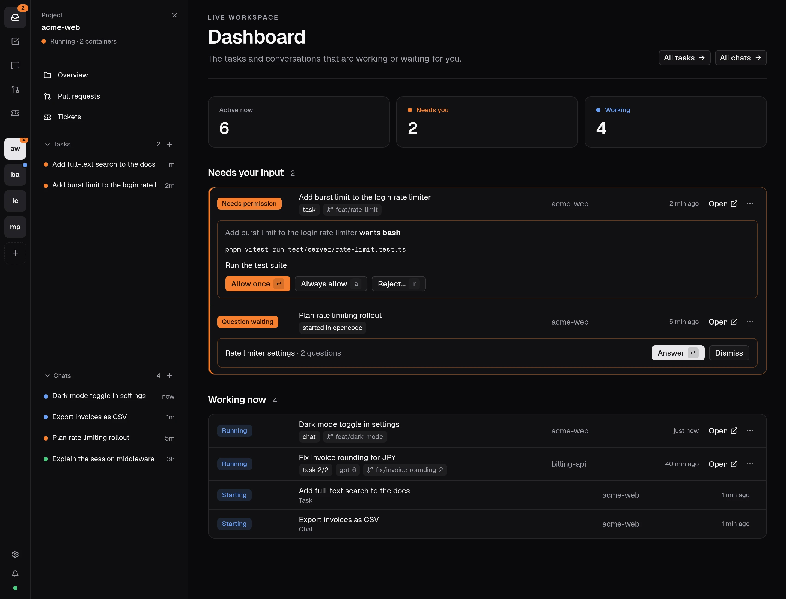

opendevhub is a dashboard that runs on your machine and orchestrates [opencode](https://opencode.ai) v2 agents. Each agent runs inside its project's devcontainer, so it gets the project's toolchain. You chat, plan, answer and review their work from one place.

## What it does

- **Finds your projects.** It discovers every folder with a `.devcontainer/devcontainer.json` (or `.devcontainer.json`) under your roots, up to two levels deep. Git repos without one can be set up with [Add project](/docs/add-project).
- **Runs the containers.** It starts, stops and rebuilds one devcontainer per project and runs `opencode serve` inside it. Containers keep running when opendevhub exits, and it reconnects to them on the next start.
- **Shows what needs you.** Live session status (running, idle, needs permission, question waiting) with the sessions that need you first, plus [notifications](/docs/notifications) that arrive even with the dashboard tab closed.
- **Opens opencode.** Each project's opencode web UI is at `http://<project>.localhost:7777`, already authenticated.
- **Starts chats and tasks.** [Chats](/docs/chats) work in an existing checkout. [Tasks](/docs/tasks) can create a git [worktree](/docs/worktrees), compare up to four models on the same prompt, and run in an [own container](/docs/worktrees#own-containers).
- **Connects the work.** Link a project to a Jira board or Forgejo repository, then follow its tickets, tasks, branches, pull requests and reviews together.
- **Ships the result.** Review the changes, then [publish](/docs/publish) a branch and open a pull request, with no `gh` and no tokens.
- **Opens your editor.** The "Open in…" menu attaches VS Code to the container, or opens the checkout in VS Code, Cursor, Zed, JetBrains IDEs, Neovide or Neovim. Only editors found on your machine are listed.
- **Forwards ports.** The ports listed in a project's `forwardPorts`, plus ports added in project settings, are forwarded to `localhost` while the project runs, using the next free port if one is taken. Project settings can also give containers access to selected [host ports](/docs/host-browser).

## Find your way around

Choose a project at the top of the sidebar. **New chat**, that project's overview, chats and linked work appear beneath it. **Tasks** and **Chats** list work across projects. Open **Settings** for roots, integrations, activity, usage and cleanup. Press `Ctrl/⌘ K` to jump to a project, task, chat or setting.

On a project overview, **To-do** keeps a short checklist for that project. Its count shows how many items are still open.

<Cards>
  <Card title="Getting started" href="/docs/getting-started" />
  <Card title="Tasks" href="/docs/tasks" />
  <Card title="Chats" href="/docs/chats" />
  <Card title="Worktrees" href="/docs/worktrees" />
  <Card title="Publish" href="/docs/publish" />
</Cards>
