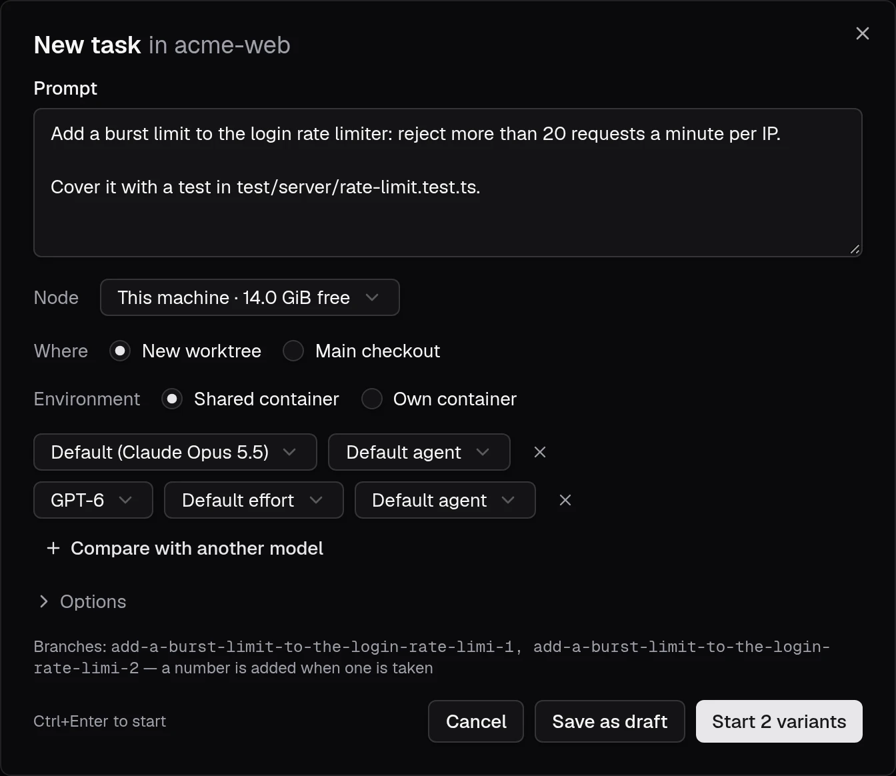
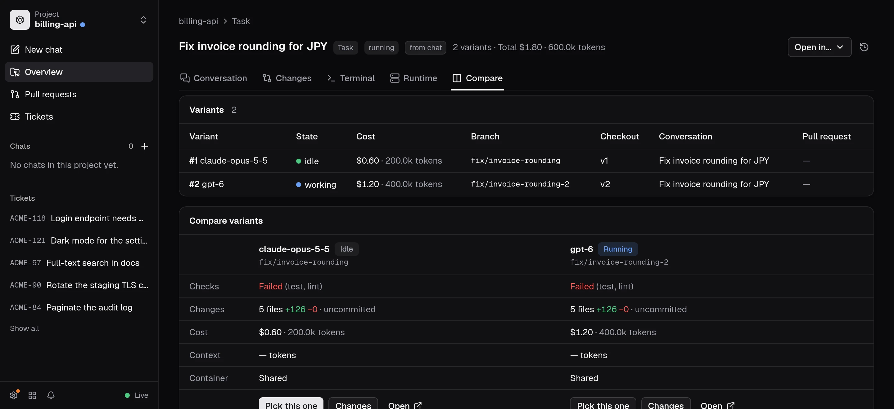
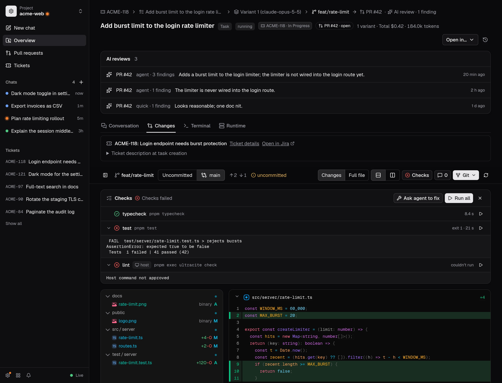

**New task** starts agent work from a prompt. Open it from a project overview, the command palette (`Ctrl/⌘ K`), or **Start as task** in [New chat](/docs/chats). The **Tasks** page lists tasks across projects and filters them by state and project.

By default a task creates a [worktree](/docs/worktrees) on a branch named after the prompt's first line (`-2`, `-3`… when the name is taken), starts a session there and sends the prompt. **Main checkout** runs it in the project folder instead. **Environment: Own container** runs it in its [own container](/docs/worktrees#own-containers).

Choose an agent and model for each variant. You can save a task as a draft and start it later. If the checkout has OpenSpec available, **Spec first** asks the agent to propose the change before implementing it. The task page shows the proposal, specs, design and tasks as they progress.

When the proposal is ready, comment on its text or requirements and send the comments to the agent for an update. **Approve and implement** starts implementation in a fresh conversation by default, keeping the same task, checkout and spec files. Clear **Start implementation in a new conversation** to continue the proposing conversation. After its tasks are complete, archive the change from the task page. A proposed change can also be implemented in separate model variants for comparison.

## Compare models

**Compare with another model** runs the same prompt on up to four models, each in its own worktree (`<branch>-<model>`). The task page compares the variants side by side: status, branch, checks, changes, cost and tokens, with Review and Open links. Below it, **Files** lines up every file the variants change, the ones they disagree on first. Each variant's cost and tokens include its subagents, and the task's total in the heading includes discarded variants.

**Pick this one** hides the other variants (it's the primary button once a variant has finished; picking one that's still working stops the others). It can also remove their worktrees and branches, after a confirmation that lists any uncommitted changes.

## Where tasks are stored

A task and its variants are stored in opendevhub's local SQLite database. Conversations remain in opencode's data volume, so tasks and their sessions survive dashboard and container restarts. Task pages also connect the originating ticket, branch, checkout, pull requests and AI reviews when those links exist.

## Conversation and changes

Open a task and select **Conversation** to see the agent's messages, tool activity, cost, tokens and subagents. The composer sends another prompt to that session, queued behind its current turn if it is still working. **Changes** and **Terminal** are available on the task and checkout pages; the conversation can also show checkout changes in its side panel.

A task groups multiple conversations. Use **Start a new conversation here** (or `/new` in its composer) to start with empty context in the same checkout. Earlier conversations stay attached to the task and can be reopened from the conversation list; their message history is not copied into the new session.

## Review and publish

Each checkout has a **Changes** tab that shows the diff. Its toolbar stays at the top while you scroll: the branch, which changes are shown, how far ahead and behind the base it is, and whether it has uncommitted changes. **Uncommitted** (the default) shows the checkout's `git diff`, new files included. Switch to the base (for example **main**) to see everything since the branch left it, committed or not; click the base again to pick another. Each checkout remembers its choice, and when nothing is uncommitted but the branch has commits, the review offers to compare with the base. By default a diff shows only the changed lines with a few lines around them; click an "unmodified lines" bar to expand it, or switch to the full file. You can also show the old and new versions side by side, and hide the changed-files tree. These choices are remembered. Modified images can be compared with **2-up**, **Swipe**, **Onion skin**, or **Difference**; the chosen mode is remembered.

Comment on a line with the **+** in the diff's gutter; the comments button collects them, takes general comments, and sends them all to a session. The **Git** menu commits, updates from the base, merges into the base, and [publishes](/docs/publish) the branch as a pull request; an action that can't run says why.

